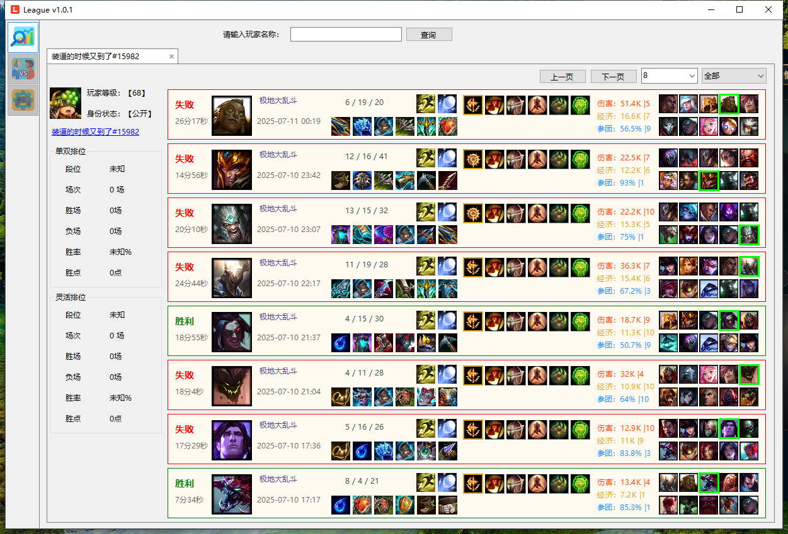
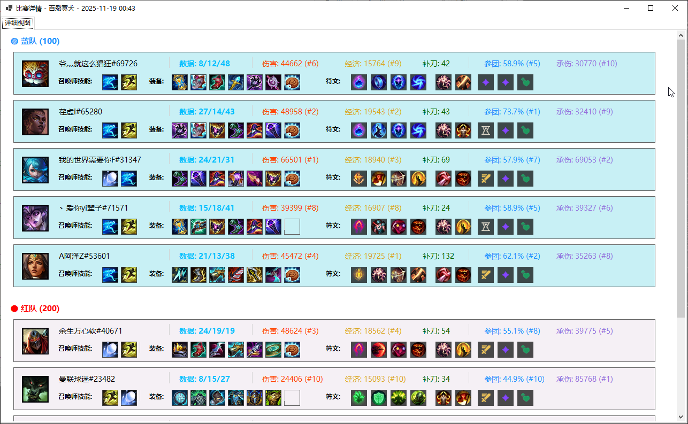
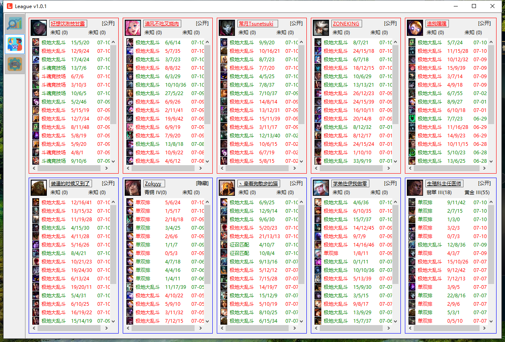
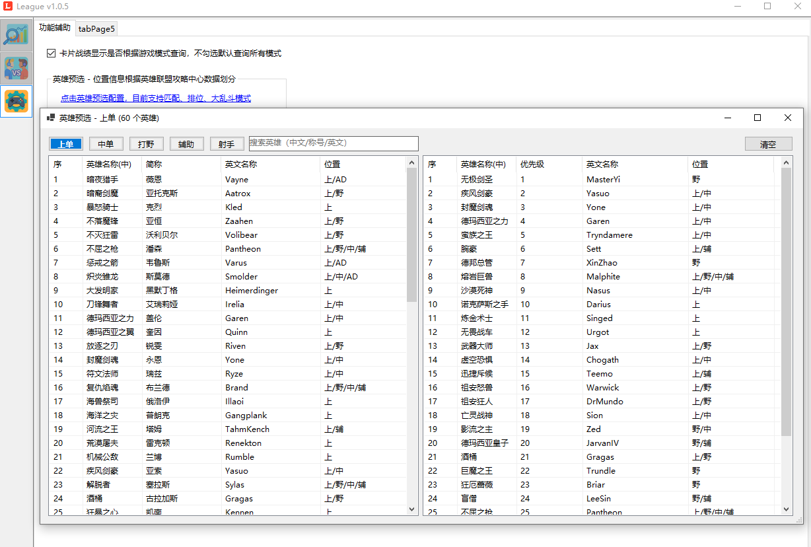
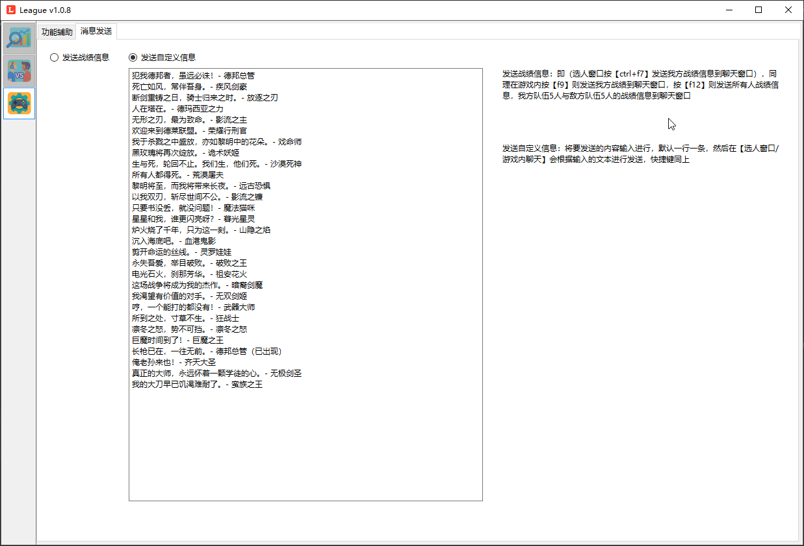
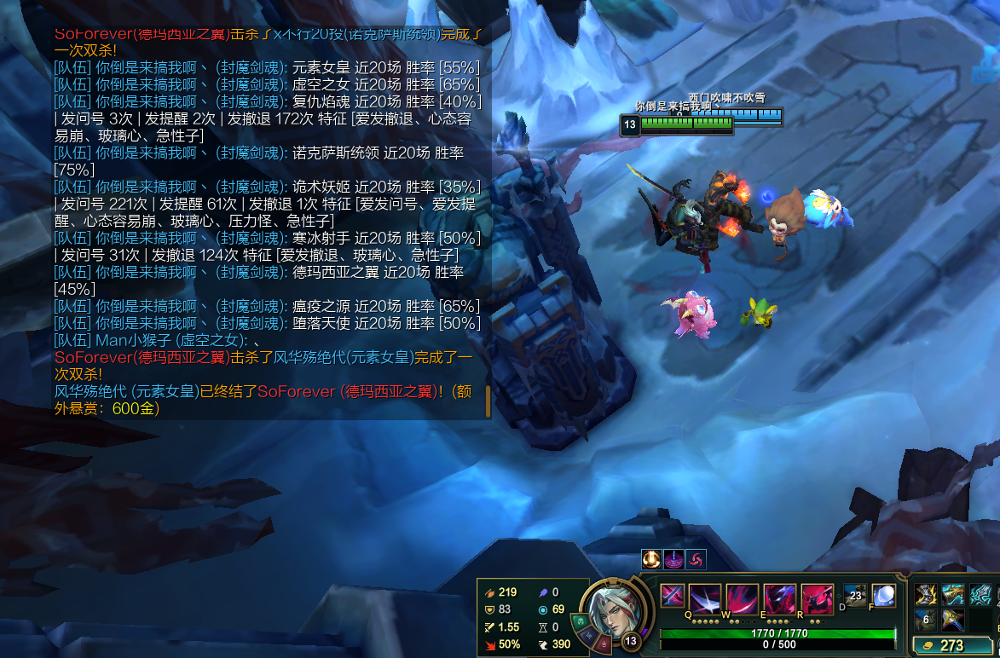

# 联盟视界
英雄联盟战绩助手工具（支持国服与外服）

> 实时查询战绩、卡片展示、选人提醒，让你的峡谷之旅更智能！

## 功能特色

### 1. 实时战绩查询
- 软件启动后自动查询当前玩家的战绩
  - 包括胜负、KDA、出装、符文配置
  - 显示本场伤害、经济、参团率及排名（与 WeGame 数据一致）

### 2. 数据筛选
- 支持匹配、单双排、灵活模式的战绩筛选
- 可按需求自定义查询范围

### 3. 选人阶段辅助
- 游戏开始选人阶段自动跳转到战绩界面
- 自动查询我方与敌方近期 20 场战绩
- 显示是否组队玩家，组队玩家名称颜色统一，便于辨识

### 4. 预选英雄配置
- 可添加常用英雄到预选区并自动保存
- 游戏时自动切换排名靠前的英雄
- 支持匹配、排位、大乱斗模式

### 5. 消息提醒功能
- 选人窗口战绩消息发送，可自定义消息
- 游戏内战绩消息发送，可自定义消息

#### 玩家行为特征标签说明

软件会根据玩家**最近 N 场**（可配置 10/20/30/50 场）表现自动生成以下行为特征标签，帮助你快速识别潜在风险玩家：

| 标签 | 触发条件（平均值） | 详细含义解释 | 风险指数 |
|------|------------------|--------------|----------|
| **爱投降** | 投降率 ≥ 35% | 投降意愿极强，逆风时非常容易发起或同意投降，属于典型的“不想打”型选手。 | ★★★★★ 极高 |
| **容易投降** | 投降率 ≥ 22% | 投降意愿明显高于普通玩家，逆风或经济落后时容易选择投降，坚持能力较弱。 | ★★★☆☆ 中 |
| **爱发问号** | 平均每场问号 ≥ 2.6 | 喜欢狂发问号，队友一旦失误或被抓就频繁标记，压力型选手，容易影响队友心态。 | ★★★★☆ 高 |
| **爱发提醒** | 平均每场提醒 ≥ 2.2 | 积极使用视野提醒信号，喜欢提示队友注意插眼和视野。 | ★★☆☆☆ 中 |
| **爱发撤退** | 平均每场撤退 ≥ 3.0 | 极其保守，稍微看到危险就频繁发撤退信号，属于“怕死型”或“爱抱怨”玩家。 | ★★★★☆ 高 |
| **爱发危险** | 平均每场危险 ≥ 2.2 | 经常标记危险信号，提示队友小心埋伏或即将被抓，预警意识较强。 | ★★★☆☆ 中 |
| **心态容易崩** | 四种信号总和 ≥ 8.0 | 信号使用量明显偏高，心态稳定性较差，逆风时容易失衡。 | ★★★★☆ 高 |
| **玻璃心** | 四种信号总和 ≥ 10.5 或 撤退 ≥ 3.8 | 心态极其脆弱，一点风吹草动就大量使用信号，容易心态崩盘。 | ★★★★★ 极高 |
| **爱抱怨** | 撤退 ≥ 4.2 且 总和 ≥ 10.0 | 极度喜欢抱怨，信号使用量极大，属于典型的“玻璃心 + 喷子”。 | ★★★★★ 极高 |
| **压力怪** | 四种信号总和 ≥ 12.5 | 信号量极大，压力外溢明显，对队友和局势高度敏感。 | ★★★★★ 极高 |
| **急性子** | 总和 ≥ 14.5 或 问号 ≥ 4.2 或 撤退 ≥ 4.8 | 极度急躁，几乎每场都在狂按信号，耐心极差。 | ★★★★★ 极高 |

**消息显示规则**：
- **有特征时**：显示对应信号的**总次数** + 特征标签
- **没有特征时**：只显示胜率

**示例输出**：

1. 干净玩家（无任何特征）  
   `张三 近20场 胜率 [52%]`

2. 轻微负面  
   `李四 近20场 胜率 [45%] | 发问号 48次 | 发撤退 55次 特征 [爱发问号、爱发撤退]`

3. 典型玻璃心  
   `王五 近20场 胜率 [38%] | 发问号 62次 | 发撤退 81次 | 发危险 35次 特征 [爱发问号、爱发撤退、玻璃心]`

4. 重度压力型（压力怪 + 急性子）  
   `赵六 近20场 胜率 [41%] | 发问号 95次 | 发撤退 108次 | 发危险 42次 特征 [爱发问号、爱发撤退、玻璃心、压力怪、急性子]`

5. 爱投降 + 心态崩  
   `钱七 近20场 胜率 [33%] | 发撤退 68次 特征 [爱投降、爱发撤退、心态容易崩]`

### 6. 自动更新
- 支持版本自动检测与更新

---

## 软件界面示例

*战绩列表界面*

*单双排比赛详情*

*对战列表展示*

*英雄预选配置界面*

*发送消息配置界面*

*发送战绩示例*

*皮肤配置界面*

---

## 历史版本更新记录

### v1.1.3（最新）
- 修复Bug若干
- 调整消息按键配置
- 优化预选英雄配置，预选更快
- 优化玩家战绩消息特征输出信息

### v1.1.2
- 修复战绩面板查询时翻页数据丢失问题
- 调理软件启动优先及，目前TCLS\client.exe会强制改为wegame启动，现已改为 startup_runner.exe 启动
- 新增配置，浏览账号已有英雄与皮肤，并可配置默认皮肤（在选人窗口时会自动切换到预选的皮肤，仅限已拥有）

### v1.1.1
- 调整软件检测游戏启动程序，防止误判，识别游戏错误
- 调整软件启动检测游戏连接方式
- 新增无限乱斗、无限火力预选配置
- 优化卡片战绩历史显示，现在是哪个先查完显示哪个
- 优化连接检测方式，现在勾选了“在游戏期间关闭客户端”的情况下也能在游戏内打开软件正常加载卡片战绩
- 如果需要游戏结束之后立即返回模式房间，把“在游戏期间关闭客户端”取消勾选即可，在游戏之后就能瞬间回到模式房间中

### v1.1.0
- 优化查找游戏启动文件逻辑
- 修复显示未知模式
- 新增卡片显示自定显示数量
- 新增自动接受对局等待时间

### v1.0.9
- 新增配置跳过点赞界面
- 新增配置路过结算界面
- 新增配置发送战绩时过滤自己开关
- 新增配置发送战绩时可以为英雄名称（能解决名称屏蔽问题）

### v1.0.8
- 新增自动接受对局配置
- 新增选人窗口战绩消息发送（可自定义消息）
- 新增游戏内战绩消息发送（可自定义消息）

### v1.0.7
- 修复战绩查询失败问题
- 修复战绩卡片丢失问题

### v1.0.6
- 修复战绩卡片丢失问题
- 新增匹配、排位、大乱斗、海克斯大乱斗自选英雄开关
- 新增自动更新功能

### v1.0.5
- 新增配置：卡片显示支持过滤模式及查询所有战绩
- 新增配置：添加匹配、排位、大乱斗英雄预选功能

---

## 下载与安装

最新版本：[League.v1.12](https://github.com/mizi6654/LeagueHistory/releases/latest)

> 将压缩包解压后运行 `League.exe` 即可，无需额外依赖。

---

## 联系与反馈
- GitHub Issues: [https://github.com/mizi6654/LeagueHistory/issues](https://github.com/mizi6654/LeagueHistory/issues)
- QQ群联系: `1035850775`
- 欢迎大家提交问题与建议，帮助“联盟视界”持续优化体验！